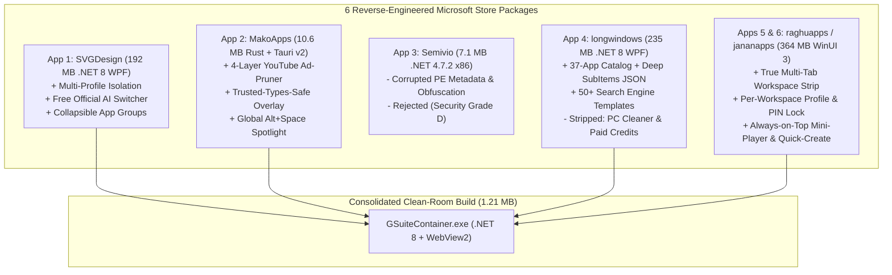

# Forensic Evaluation of 6 Microsoft Store Google Launcher Apps & Consolidated `GSuiteContainer` Architecture

> [!IMPORTANT]
> **Executive Verdict**:
> 1. **Strongest Engineering, Efficiency & Security**: **App 2 (`9971MakoApps` / `g-app-launcher.exe`)** wins on technical execution, security posture (`A+`), and footprint (**10.63 MB**, Rust + Tauri v2 + React 19), featuring a Trusted-Types-safe auto-hide overlay toolbar and a 4-layer YouTube ad-pruner, but lacks multi-tab browsing and gates >2 custom apps and ad-blocking behind a `\$24.99` paywall.
> 2. **Most Capable Multi-Tab & Workspace Feature Set**: **Apps 5 & 6 (`32249raghuapps` & `27501jananapps`)** are **98% identical white-label clones** (`Samuno.Billing` codebase) sharing the same Google Cloud backend (`metal-mariner-314809`). They deliver true in-window multi-tab workspaces, per-workspace WebView2 profile isolation, PIN/Windows Hello locks, uBlock Origin Lite (`uBOL`), a floating YouTube mini-player, and a meeting auto-launcher, but are **severely bloated (`363.8 MB` each)**.
> 3. **Consolidated Clean-Room Build**: All standout capabilities from Apps 1, 2, 4, 5, and 6 have been consolidated into a 100% free, zero-telemetry, **1.21 MB** native `.NET 8.0` + WebView2 container: `GSuiteContainer.exe` (`src/GSuiteContainer.cs`).

---

## 1. Master Head-to-Head Forensic Matrix

Static binary analysis (`System.Reflection.Metadata`, PE CLI headers, `#US` UTF-16LE user string heaps, and Brotli-compressed Tauri asset extraction) revealed that the **6 Store applications actually belong to 4 codebase families**:

| Rank | Store Package & Binary | Codebase Family & Stack | Disk Size (Files) | Tabs & Window Model | Profile Isolation | Ad-Blocker Engine | Security & Privacy Grade | Freemium Paywall & Red Flags |
| :--- | :--- | :--- | :--- | :--- | :--- | :--- | :--- | :--- |
| **#1 (Efficiency & Craft)** | `g-app-launcher.exe` (`9971MakoApps`) | **Family B**: Rust (`rustc`) + Tauri `2.11.5` + React 19 | **10.63 MB** (17 files) | Separate window per app; Trusted-Types-safe auto-hide top bar | Single WebView2 profile | **4-Layer Custom YouTube + Network Pruner** (`src\adblock\mod.rs`) | **A+** (Zero external backends, zero telemetry, minimal Rust surface) | Gates >2 custom apps (`const Br=2`), custom hotkeys, and YT adblock behind `\$24.99` Store add-on |
| **#2 (Workspace Features)** | `gservices.exe` (`32249raghuapps`) & `launcher.exe` (`27501jananapps`) | **Family D (Clones)**: `.NET 8.0` ReadyToRun + WinUI 3 (`Samuno.Billing`) | **363.75 MB** / **363.83 MB** (426 / 436 files) | **True In-Window Multi-Tab Strip** + Dock + Search Widget + Mini-Player | **Per-Workspace Isolated Profiles** + PIN / Windows Hello Lock | Bundled **uBlock Origin Lite (`uBOL`)** MV3 extension | **B-** (Phones home to `metal-mariner-314809.cloudfunctions.net`; creates Task Scheduler jobs) | 98% identical white-label clones sold under two publisher names; bundles 38 MB of unused `onnxruntime.dll` + `DirectML.dll` |
| **#3 (Clean .NET Base)** | `GAppLauncher.exe` (`SVGDesignSolutions`) | **Family A (Clean Branch)**: `.NET 8.0` WPF + WebView2 `1.0.2903.40` | **192.36 MB** (519 files) | Separate `BrowserWindow` per app with bottom bar (no tabs) | **Multi-Profile Isolation** (`UserProfile`) + Collapsible Groups | Basic network filter + CSS cosmetic hide | **A-** (No external telemetry or third-party AI proxy servers) | Spawns hidden background WebView2 monitors (`GmailBackgroundMonitor`, `CalendarBackgroundMonitor`) that consume idle RAM |
| **#4 (Catalog vs. Bloat)** | `GAppsServer.exe` (`27822longwindows`) | **Family A (Bloated Branch)**: `.NET 8.0` WPF (`GAppsServer.dll`) | **235.27 MB** (581 files) | Separate `BrowserWindow` per app + global mouse hook | Multi-Profile Isolation | Same as App 1 (Pro-gated) | **C-** (Installs global `WH_MOUSE_LL` hook; routes AI/OCR to OpenRouter, Baidu, Sogou) | Double-dip monetization (Pro license + consumable AI credits); bundles unrelated PC disk cleaner (`CleanupFileDeletionService`) |
| **#5 (Avoid)** | `GLauncher.exe` (`9601Semivio`) | **Family C**: 32-bit `.NET Framework 4.7.2` + 2021 WebView2 (`1.0.864.35`) | **7.10 MB** (48 files) | Single primitive WebView2 window | None | None | **D (Unacceptable)** | Heavily obfuscated (`kLjw4iIsCLsZtxc4lksN0j`), encrypted resources (`Comparator.Event`), and corrupted PE CLI metadata tables |

---

## 2. Deep-Dive Architectural & Capability Findings

### 2.1 Standout Capabilities Extracted per Application
1. **From App 2 (`9971MakoApps` / `g-app-launcher.exe`)**:
   - **Trusted-Types-Safe DOM Injection (`src\appwindows.rs`)**: Google Workspace login and admin pages enforce strict Content Security Policy (CSP) `require-trusted-types-for 'script'`, which breaks any container that injects UI via `innerHTML`. App 2 constructs its overlay strictly via `document.createElement` and mounts on `document.documentElement` (`<html>`) so SPA `<body>` swaps never destroy container bindings.
   - **Context-Aware `Ctrl+[` / `Ctrl+]` Back/Forward Shortcuts**: Explicitly checks `el.tagName === 'INPUT' || el.tagName === 'TEXTAREA' || el.isContentEditable` before handling `Ctrl+[` and `Ctrl+]`, preventing collisions with Gmail and Google Docs text-indentation shortcuts.
   - **4-Layer YouTube Ad-Pruner (`src\adblock\mod.rs`)**:
     1. Network-level `WebResourceRequested` blocking of `doubleclick.net`, `googlesyndication.com`, `googleadservices.com`, `youtube.com/api/stats/ads`, `youtube.com/pagead/*`, and `youtube.com/ptracking`.
     2. Document-start `Object.defineProperty(window, 'ytInitialPlayerResponse')` setter trap that strips `adPlacements`, `playerAds`, `adSlots`, and `adBreakHeartbeatParams` before the player initializes.
     3. `window.fetch` interception on `/youtubei/v1/player` and `/youtubei/v1/next` JSON payloads to strip mid-roll ad slots dynamically.
     4. Cosmetic CSS hiding of `ytd-ad-slot-renderer` and a 300ms watcher that clicks `.ytp-ad-skip-button-modern` or fast-forwards unskippable ad video elements (`v.currentTime = v.duration`).
2. **From Apps 5 & 6 (`32249raghuapps` & `27501jananapps`)**:
   - **True In-Window Tabbed Workspace Strip (`WebTabService`)**: Keeps all active Google apps inside a single unified window rather than spawning 10 separate taskbar windows.
   - **Per-Workspace Isolated `CoreWebView2Environment` + Account Auto-Detection (`BrowserAccountObservation`)**: Maps each workspace (`Personal`, `Work`, `Executive`) to its own physical Chromium user-data folder so multiple `accounts.google.com` sessions never cross-contaminate or force account-index (`/u/0/` vs `/u/1/`) redirects.
   - **Workspace PIN Security (`WorkspaceSecurityService`)**: Per-workspace lock screen protecting sensitive corporate or financial tabs.
   - **Always-on-Top Picture-in-Picture Mini-Player (`MiniPlayerWindow`) & Quick-Create Bar**: One-click `+ New Doc/Sheet/Slide/Form/Event/Meet/Note` creation endpoints.
3. **From App 4 (`27822longwindows` / `GAppsServer.exe`)**:
   - **Rich 38-Service Catalog with Deep `SubItems` (`Data\apps.json`)**: Right-click or click the `▾` badge on any service to jump directly into deep sub-routes (e.g., Gmail `Compose / Starred / Sent / Drafts / Spam`, Drive `My Drive / Shared with me / Recent / Quota`, Docs/Sheets/Slides `Create Blank / Templates`, Cloud Console `IAM / APIs / Cloud Run / BigQuery / Billing`).
   - **Scoped Search Engine Templates**: Instant prefix and pill switching (`g`, `yt`, `m`, `d`, `doc`, `cal`, `map`, `sch`, `ai`, `px`, `ddg`, `gh`).
4. **From App 1 (`SVGDesignSolutions` / `GAppLauncher.exe`)**:
   - **Free Official AI Companion Switcher (`AiChatWindow`)**: Side-by-side access to official **Gemini**, **NotebookLM**, **Google AI Studio**, **ChatGPT**, **Claude**, and **Perplexity** web interfaces using the user's own browser session (eliminating App 4's paid OpenRouter token middleman and Apps 5/6's `metal-mariner-314809` Cloud Function proxy).
